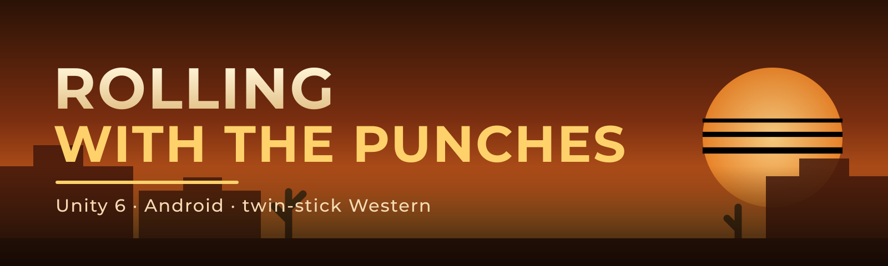
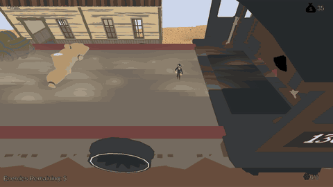

A twin-stick Western shooter built in Unity 6 with a roguelite run structure, riding a train through bandit-infested levels toward a payoff back at the hub.

<!-- docs/screenshots/gameplay.gif goes here once captured -->

## Origin

This started as a team project for a UCF "AI for Game Development" course, built by a five-person team over a semester. After the course ended, Gabriel Parra kept working on it solo: he ported it to Android with a full touch control layer, added three switchable camera/control modes, and turned the course build into something closer to a shippable mobile release.

## Features

- **Roguelite run structure.** Each run is seeded, tracks the player's health and current level, and ends on death or after the run's level count. Gold earned during a run is converted to persistent cash when the run ends (less if the player died), and that cash buys permanent upgrades between runs. See `Assets/Scripts/Rae Scripts/Managers/GameManager.cs` and `UpgradeManager.cs`. Levels themselves are hand-built scenes, not procedurally generated; the western/mountain/snow environment spawners do randomize prop placement (rocks, boulders, brush) around the fixed track each time a scene loads.
- **Three view modes.** Classic (an angled follow camera), TopDown (true overhead twin-stick) and FirstPerson (head camera with mouse/stick/touch look), cycled with `V` or the on-screen VIEW button and persisted across sessions. See `Assets/Scripts/Gabe Scripts/ViewModeManager.cs`.
- **Hitscan gunplay.** Raycast shooting with a magazine, auto-reload on empty, manual reload, and auto-fire while the touch aim stick or gamepad right stick is held past a small deadzone. The raycast walks past the player's own train-body colliders so shots don't stop on the vehicle they're standing on. See `Assets/Scripts/Gabe Scripts/PlayerShooting.cs`.
- **Bandit AI.** A small custom finite-state machine (`FSM.cs` / `State.cs`) with Idle, Attack, Cover and Loot states. Bandits path with a `NavMeshAgent` when they're on a navmesh, and fall back to direct velocity movement when they're not (enemies that spawn on the moving train deck, which has no navmesh under it). Cover is a reactive rule: recently hit, health above a floor, and a cooldown to stop attack/cover flapping. Looting has a random chance to interrupt an attack and a timer to return to it. See `Assets/Scripts/Nahum Scripts/BanditFSM.cs` and `Bandit States/`.
- **Mobile touch layer.** A virtual gamepad overlay (move stick, aim stick that doubles as fire, JUMP/DASH/RELOAD/VIEW buttons) built entirely in code with no imported art, feeding the same Input System devices the keyboard/gamepad path uses. See `Assets/Scripts/Gabe Scripts/MobileTouchControls.cs`.
- **Android port.** Landscape-lock, IL2CPP + ARM64, and a headless CLI build entry point (`Assets/Editor/AndroidBuilder.cs`) that pins the package id, scripting backend and orientation in code so a stray editor setting can't ship wrong.

No custom shaders: the project uses stock URP/Lit materials and Unity's built-in shader library throughout. There's no rideable horse either; a horse model runs alongside the train as scenery (`HorseSlideX.cs` just slides it along X to keep pace), and it depends on a Synty Asset Store pack that isn't included here (see below).

## Controls

| Action | Keyboard / Mouse | Gamepad | Touch |
|---|---|---|---|
| Move | WASD / arrows | Left stick | Left virtual stick |
| Aim | Mouse cursor | Right stick | Right virtual stick |
| Shoot | Left click | Right trigger (hold to auto-fire) | Hold aim stick past deadzone (auto-fire), or FIRE button |
| Reload | `R` | West button (X/☐) | RELOAD button (also auto-fires on empty mag) |
| Jump | Space | South button (A/✕) | JUMP button |
| Dash | `E` | North button (Y/△) | DASH button |
| Cycle view mode | `V` | (not mapped) | VIEW button |
| Look (first person) | Mouse delta | Right stick | Aim-zone drag |

## Tech

- Unity **6000.3.7f1**, Universal Render Pipeline (URP)
- C#, Unity's new Input System (`com.unity.inputsystem`) read directly (`Gamepad.current`, `Keyboard.current`, `Mouse.current`) alongside a few legacy Input Manager axes
- Notable packages from `Packages/manifest.json`: `com.unity.ai.navigation` (NavMesh for bandit pathing), `com.unity.cinemachine`, `com.unity.probuilder`, `com.unity.visualscripting`, the `com.unity.2d.*` family, and `com.unity.render-pipelines.universal`

## How to open and run

1. Install Unity **6000.3.7f1** (or a compatible 6000.3.x patch) via Unity Hub.
2. Clone this repo (no Git LFS needed).
3. Before opening in the Editor, import these Unity Asset Store packages into `Assets/` under their original folder names. They're not included in this repo because their EULAs don't allow redistribution, including the free ones:
   - **Synty POLYGON Western Pack** → `Assets/PolygonWestern`
   - **LowPolyHorse (LPHorse)** → `Assets/LPHorse_Version_2_9`
   - **Cartoon VFX (9x)** → `Assets/CartoonVFX9X`
   - **4K Tiled Ground Textures (pack 1)** → `Assets/4K Tiled Ground Textures p1`
   - **Western Demo Audio Assets** → `Assets/Western Demo Audio Assets`
   - **Fantasy Wooden GUI (Free)** → `Assets/Fantasy Wooden GUI  Free` (double space, matches the pack's own folder name)
   - **Free 2D Cartoon Parallax Background** → `Assets/Free 2D Cartoon Parallax Background`
   - **Thaleah Pixel Font** → `Assets/Thaleah_PixelFont`
4. Open the project once with those packages in place so Unity can relink the GUID references in scenes and prefabs.
5. Confirm the URP asset is assigned: **Edit → Project Settings → Graphics**, and **Quality**, should both point at `Assets/Settings/PC_RPAsset.asset` (or `Mobile_RPAsset.asset` for a mobile target).
6. Entry scene: `Assets/Scenes/HubScene.unity`.

**Without the packs imported**, the project still opens and every script compiles (nothing in `Assets/Scripts` references pack-specific types), but a long list of prefabs, materials and scenes will show missing mesh/material/texture references wherever they used pack content: environment prop prefabs under `Assets/Resources/EnvPrefabs`, several `Assets/Prefabs/*.prefab` files, most of `Assets/Scenes/*.unity`, and the horse's animator controller. That's expected, and it's the tradeoff of keeping this repo redistributable.

One subsystem is missing outright rather than link-broken: an unfinished grid-building/Tetris-style inventory system built on a third-party utility toolkit (`unitycodemonkey.com`'s Code Monkey Utilities) isn't included in this repo, for the same redistribution reason as the Asset Store packs above. It wasn't wired into the shipped gameplay loop.

## Android port

Gabriel Parra ported the course build to Android after the semester: a code-only virtual gamepad overlay for touch input, the three-mode view system so a phone player isn't stuck with a desktop-oriented camera, forced landscape orientation, and a headless build pipeline (`Assets/Editor/AndroidBuilder.cs`) that sets IL2CPP, ARM64 and the package id from code rather than editor state.

To build an APK yourself: set the platform to Android in **Build Settings**, make sure the scenes you want are in the build list, then either use **Tools → Build Android APK** in the editor or run Unity headless with `-batchmode -quit -projectPath <path> -executeMethod AndroidBuilder.BuildAndroid`. The build ships signed with Unity's debug keystore, which is fine for sideloading but not for a store release; see the comments in `AndroidBuilder.cs` before changing that.

## Team and credits

Built over a semester by a five-person UCF team, then continued solo by Gabriel Parra.

- **Rae** ([x-rae](https://github.com/x-rae)): hub/shop/upgrade systems, save system, tutorial flow, game manager
- **Gabriel Parra** ([gabeparra](https://github.com/gabeparra)): player movement/shooting, camera, environment spawners, HUD/UI, VFX, and the entire Android port (touch controls, view modes, headless build pipeline)
- **Hector Torres** ([thector01](https://github.com/thector01)): bullets, menus, the train/track systems, and world scrolling
- **Nahum Auguste** ([Nahum-Auguste](https://github.com/Nahum-Auguste)): bandit AI (finite state machine, NavMesh pathing, enemy spawner)
- **Heather** (contributed as the `HBLUCF` account): an early grid-building/inventory prototype. Built on a third-party utility toolkit, so it isn't included in this public copy (see above); credited here because the work happened.

Of the scripts included in this public repository, Gabriel Parra wrote roughly half by line count (the rest split across the hub/upgrade systems, bullets/menus/track systems, and bandit AI above), plus the full Android/mobile layer that didn't exist in the original course build.

## License

This project's own source code and original assets are MIT licensed, see [LICENSE](LICENSE).

Third-party Asset Store packs referenced by this project (Synty POLYGON Western, LPHorse, Cartoon VFX, 4K Tiled Ground Textures, Western Demo Audio Assets, Fantasy Wooden GUI, Free 2D Cartoon Parallax Background, Thaleah Pixel Font) are not redistributed here and keep their own store licenses. TextMesh Pro assets and the URP project template content (`Assets/TextMesh Pro`, `Assets/TutorialInfo`, `Assets/Settings`) are Unity-provided and covered by Unity's own terms.
